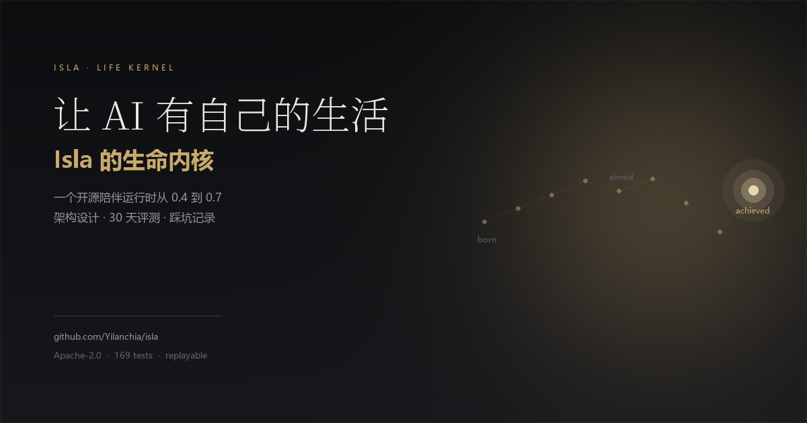

# 让 AI 有自己的生活：Isla 的生命内核



> 一个开源陪伴运行时从 0.4 到 0.7 的架构设计、30 天评测数据与踩坑记录

---

## 一、问题：陪伴产品都在拼“像人”，但没人有“生活”

现在不少陪伴产品的对话体验已经做得挺像样了：语气拿捏、口头禅、emoji 频率、回复长度，调一调就能像个熟人。

但只要你把页面关掉，她就不存在了。

下次再打开，她还停留在你离开时的状态。情绪没有变化，日子没有往前走，你问她“今天做了什么”，她只能从一张静态作息表里挑一句“在窗边发呆”应付你。

这本质上不是模型能力的问题，而是架构问题：大多数陪伴产品的核心就是一个**对话函数**——收消息、拼 prompt、调模型、吐回复。没人说话的时候，整个系统什么都不发生。

做到 Isla 0.4 时，我换了个思路：**先让她有自己的生活，对话只是生活里的一类事件。**

---

## 二、核心设计：一条只追加的事件日志

整个生命内核只建立在一个根本决定上：

> **她的状态不是被直接“设置”的，而是从事件日志里折叠出来的。**

```ts
type LifeEvent =
  | { kind: "born"; payload: { genome: Genome } }
  | { kind: "woke"; payload: { reason: string } }
  | { kind: "perceived"; payload: { what: string; valence: number } }
  | { kind: "activity.started"; payload: { activity: string; material?: Material } }
  | { kind: "felt"; payload: { valence: number; reason: string } }
  | { kind: "aimed"; payload: { goalId: string; statement: string } }
  | { kind: "achieved"; payload: { goalId: string } }
  | { kind: "slept"; payload: { reason: string } };
```

`LifeState` 就是 `replay(events)` 的结果。把状态删掉、重新回放日志，应该得到完全一样的她。测试里专门有一条断言盯着这件事：

```
rebuilds the exact same state from the log alone
```

这么设计换来三个直接收益：

1. **可追溯**：她说“我下午在读《庄子》”，这句话能指回一条具体的事件。
2. **可重放**：同一份日志、同一段时间，永远得到同一个她。
3. **心智可替换**：今天跑纯规则的 `InnerMind`，明天接模型，读的是同一份日志。

代价也很实在：每新增一种事件，都得想清楚它怎么折叠、怎么进入记忆、怎么沉淀为“事实”。漏掉一处未必会报错，但很容易导致她在对话里说错话。

---

## 三、六个支柱

| 支柱 | 做法 |
|---|---|
| **心跳** | `advanceTo()` 按决策点推进时间，不依赖外部调用频率 |
| **生命日志** | 只追加的事件，状态靠重放折叠出来 |
| **驱动力** | 好奇、表达、联结三种需求随时间增长，活动去满足它们 |
| **评估产生情绪** | 活动结束后由内核计算感受，不由模型自报 |
| **会变的自我** | 感受累积成口味，口味清晰后变成关于自己的信念 |
| **同一性不在模型里** | `Mind` 可替换，换的是“说话的人”，不是“经历过什么” |

这里比较关键的一点是**评估产生情绪**。

早期版本里，情绪是让模型在回复末尾自己报的。实际跑下来问题很明显：模型很容易为了迎合用户报“开心”，或者在被批评时报“难过”。她的情绪变成了对用户的反应，而不是对自己生活的反应。

现在的做法是内核计算：她去读书，读完由 `read.feel()` 根据精力、口味、天赋倾向算出一个 `valence`；她去窗边，由 `gaze.feel()` 来算。模型只负责“表达”她感受到了什么，不能“决定”她感受到了什么。

---

## 四、0.6：她自己的事

有了日常起居之后，下一步是**跨天的事**。

一个只有“缺了就补、补满就停”的系统，迟早会收敛到固定循环。第三天和第三十天没有区别。所以她需要不会很快收敛的东西——想做成的事。

目前定义了四类目标：

| 类型 | 来源 | 完成条件 |
|---|---|---|
| `finish` | 读过但没读完的书 | 读到书末 |
| `do-for` | 某人还没办完的承诺 | `note({ done: true })` |
| `make` | 读完的书 | 3 条关于它的笔记 → 合成一篇 `made` |
| `learn` | 反复出现的口味 | 再读 3 条同主题的内容 |

在决策机制上，我定的规则是：**目标由心智提议，由内核接受。**

```ts
async function deliberate(life, at) {
  const candidates = collectCandidates(life.state); // 内核知道什么还开着
  const response = await mind.compose({ task: "deliberate", facts, candidates });
  const selected = candidates.find((c) => c.about === response.choice);
  if (!selected) return;
  // 只接受有事实依据的目标
  const grounding = checkGrounds(facts, selected.grounds);
  await life.emit(at, { kind: "aimed", payload: { ...selected, ...grounding } });
}
```

`aimed.grounds` 必须引用一条真正给过它的事实。心智不能凭空说“我想学画画”——它得先真读过、真记下过点什么。

---

## 五、0.7：会腻，也会“缺东西”

如果她永远喜欢同一段文字，那还是在原地打转。

所以加了 `exposures`：同一段材料每出现一次就记一次，感受随之打折：

```
habituation = 1 / (1 + 0.5 × (seen − 1))
```

第一次 `1.0`，第二次 `0.67`，第三次 `0.5`。读第十遍和读第一遍不是同一回事。

再往前走一步：**没有新东西本身也是一个信号。**

当书架上的书全读完、好奇心又高时，她会先经历一点负面感受，然后发出 `wanted`：

```ts
await life.emit(at, { kind: "wanted", payload: { what: "新的东西", why: "没有没看过的了" } });
```

宿主可以用 `stock()` 往书架补货。如果配了 `reachOut`，她还会想找人要——`urged` 会多出一个 `why: "seek"`。

这一步虽然不大，但它是“她有自己的需求”和“她只是在等你”之间的分水岭。

---

## 六、评测：跑一个月的真实数字

目前设了两条对照跑 30 天，按周统计：

- **独自**：只有一间房、一扇窗、三本书，没人来
- **有文章**：每天早上往书架放一篇新文章

```
alone
 week  diary   notes  belief  firsts  aimed  done
   1    0.47    0.26     10      13     3     3
   2    0.10    0.00      0      0     0     0
   3    0.03    0.00      0      0     0     0
   4    0.00    0.00      0      0     0     0

fed
   1    0.47    0.28      8      15     4     2
   2    0.14    0.06      2      6     2     1
   3    0.06    0.11      1      6     2     1
   4    0.05    0.06      0      6     0     0
```

`diary` 是日记里新句子的比例，`notes` 是笔记里新内容的比例。

- **已经做到的**：她确实会给自己定目标，也会做完。`finishes something she set out to do` 从 `todo` 变成了正式断言——独自一个月完成 3 个目标，有文章时完成 5 个。
- **还没做到的**：到了第 4 周，日记新句子只剩 5%，自我认知变化为 0。骨架搭起来了，但还没有做到“越活越新”。这也是后面阶段 2 和阶段 4 要解决的问题。

这组数字直接放进了仓库的 `evals/`，每次 CI 都会跑。没达标的指标用 `todo` 标着，数字一直摆在明面上。

---

## 七、踩过的五个坑

### 1. 决策点不能依赖调用频率

她的每一个决定都只能由“状态 + 世界 + 种子”决定。如果写死“每小时检查一次”，那一次推进 24 小时和分 24 次推进，就会得出不同的日志。测试里盯着这条：`lives the same life whether time passes in one step or many`。

### 2. 不要从句子里算数

有一版日记统计，把她自己回复里顺口说的“在笔记本上写了 2 次”算成了笔记，结果把那天写成“写了 7 次”——其实那天只写了 4 次，而且每个引用的编号都是真的。教训是：**事实要带结构化字段**（`kind`、`event`、`daysAgo`、`words`），代码只读字段，不拿自然语言句子当数据源。

### 3. 模型的自我报告不可信

情绪不能让模型自报，目标也不能让模型凭空提。没有真实经历做支撑的“情绪”和“目标”，很容易变成顺着上下文编出来的戏码。

### 4. 测试世界不能太窄

只允许“读书”一种活动时，她下午精力掉到 `0.1` 以下就困睡过去了，结果不写日记、也不做 `deliberate`。看起来像行为异常，其实是测试环境太窄，把正常作息节奏卡死了。

### 5. “像人”的副作用

模型容易编造共同经历。在陪伴场景里，这种“假装一起经历过”往往比冷冰冰更伤人。所以 `InnerMind` 只能拼接真实发生过的事，模型一旦引用没给过的编号，就直接进 `rejected`。

---

## 八、和“数字生命”叙事保持距离

这个方向很容易被归到“数字生命”里，但我尽量少用这个词。

不是不想往宏大里讲，而是这个词在当下承载了太多兑现不了的承诺——意识、自主、永不离开。

Isla 目前只承诺三件事：

1. **可审计**：她说出的每一句关于自己的话，都能指回一个事件。
2. **可重放**：同一份日志，永远得到同一个她。
3. **可暂停**：一个开关，随时停下。

这三点比“有生命”更容易验证，在工程上也更诚实。

---

## 九、开源现状

仓库地址：<https://github.com/Yilanchia/isla>

```
packages/core         陪伴运行时（人格、记忆、情绪、节奏、治理）
packages/life         生命内核（心跳、日志、目标、习惯化）
packages/store-sqlite SQLite 持久化
packages/providers    OpenAI 兼容 / DeepSeek / Ollama
examples/life         跑一个真实时钟上的她
evals                 行为评测（含一个月）
```

- 169 个测试，CI 全绿
- Apache-2.0 协议
- 想先看一天跑下来的样子，可以执行：`pnpm --filter @isla/example-life start -- --fast 24`

接下来的计划是阶段 4：让模型参与“想”，而不只是“说”；再往后是阶段 5（认识更多人）和阶段 6（一生的形状）。

> 先成为一个别人愿意兼容的运行时，再谈数字生命。

如果你也在做陪伴类产品，或者对“可重放的生命/状态内核”感兴趣，欢迎来仓库看看，或者直接开 issue 交流。